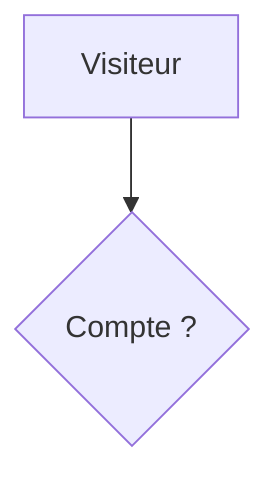
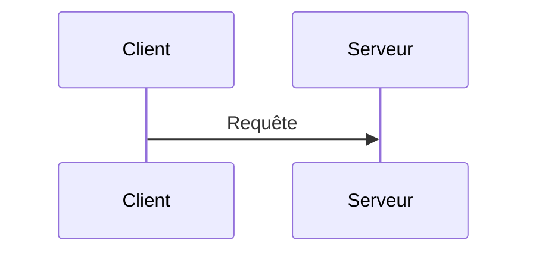

# Diagrams

Write diagrams as `mermaid` fenced code blocks. Every diagram must carry an
`accTitle` (short name) and an `accDescr` (long description), because Mermaid
turns them into the SVG accessible name and description. `prepare-static`
fails the build when either is missing, with the file and line.

````md

````

`accDescr` can span several lines with braces:

````md

````

State what the diagram shows in the surrounding text, so readers who cannot
see the graphic get the same information. See the WAI Complex Images tutorial
for the two-part alternative: a short name and a long description.

In the article, the diagram renders inline. An expand button opens a
fullscreen view with zoom, pan, keyboard controls, source copy, and SVG
download. Copies and exports carry the attribution: diagram title, author,
blog, article date, and the CC BY 4.0 license.

## Implementation

- `src/lib/markdown/mermaid.ts`: Sätteri hast plugin. Turns
  `pre > code.language-mermaid` into `pre.mermaid`. `astro.config.mjs` must
  keep `mermaid` in `markdown.syntaxHighlight.excludeLangs`.
- `src/lib/content/mermaid.ts`: fence scanner and accessibility contract,
  enforced by `scripts/prepare-static.ts`.
- `src/components/mermaid.client.ts` and `src/components/mermaid/`: client
  renderer, theme mapping, labels, dialog, and export.
- `src/styles/mermaid.css`: figure and dialog styles.
