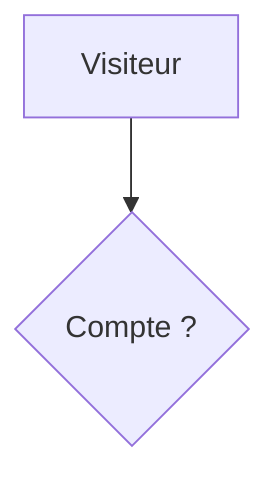
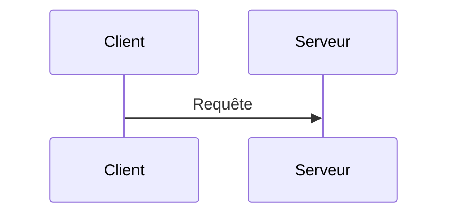

# Diagrams

Write diagrams as `mermaid` fenced code blocks. Every diagram must carry an
`accTitle` (short name) and an `accDescr` (long description), because Mermaid
turns them into the SVG accessible name and description. `prepare-static`
fails the build when either is missing, with the file and line.

````md

````

`accDescr` can span several lines with braces:

````md

````

Describe the diagram in the surrounding text. See the
[WAI Complex Images tutorial](https://www.w3.org/WAI/tutorials/images/complex/).

Copies and exports are attributed: title, author, blog, date, CC BY 4.0.

Keep `mermaid` in `markdown.syntaxHighlight.excludeLangs` in
`astro.config.mjs`.
