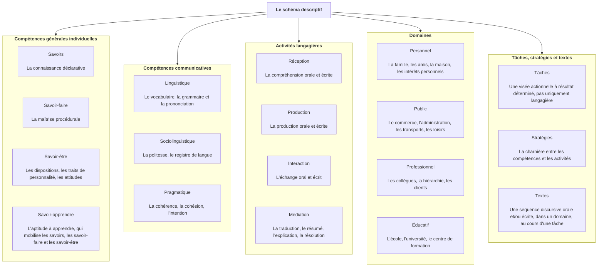
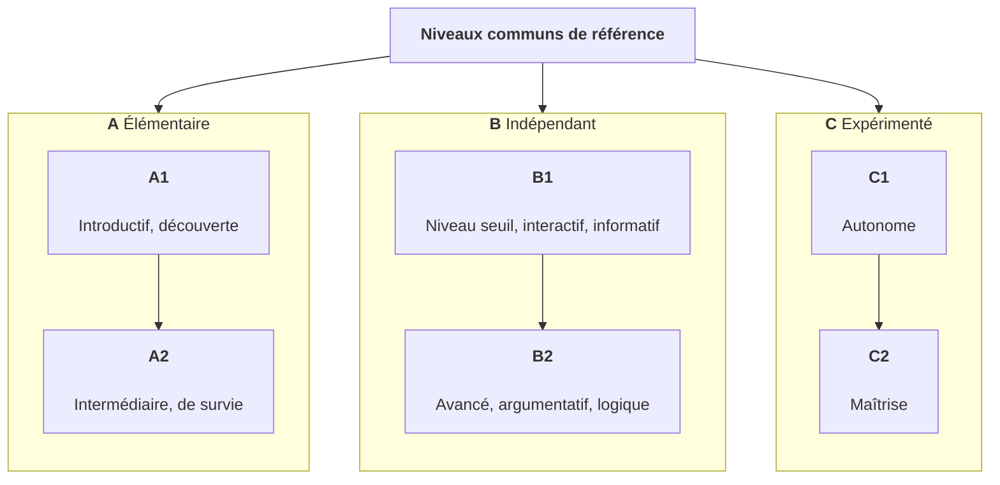
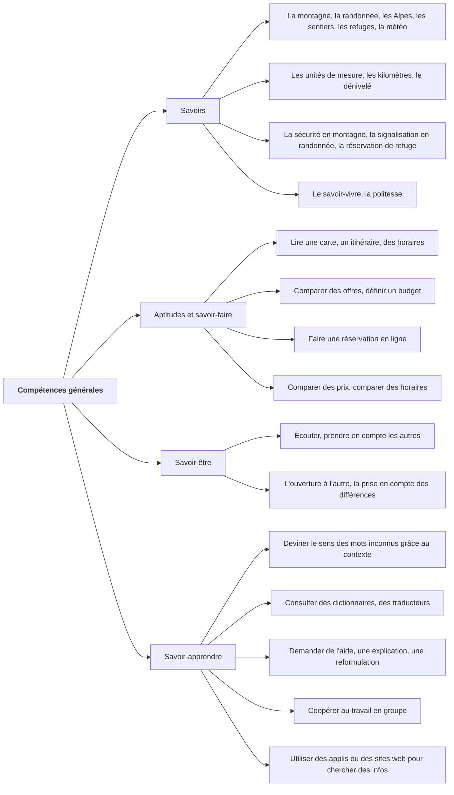
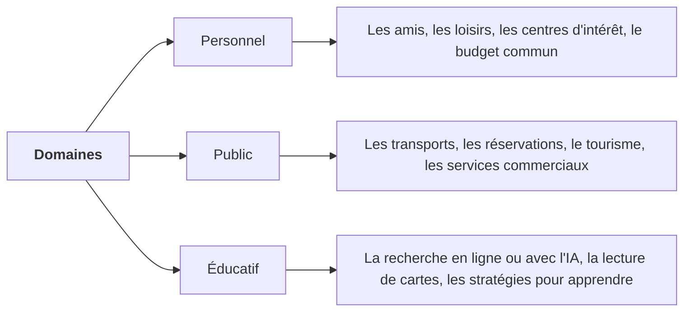

# Le CECRL est plus qu'une simple grille de niveaux

_Le CECRL propose une échelle descriptive détaillée des capacités d'un apprenant à un niveau donné. Ces descripteurs, qui suivent la perspective actionnelle, sont très pratiques pour les apprenants et les enseignants._

Le [Cadre européen commun de référence pour les langues (CECRL)](https://rm.coe.int/16802fc3a8) a été publié en 2001 par le Conseil de l'Europe. De nombreux enseignants de français langue étrangère (FLE) utilisent [sa grille d'auto-évaluation](https://rm.coe.int/CoERMPublicCommonSearchServices/DisplayDCTMContent?documentId=090000168045bb57). Elle couvre les niveaux du A1 au C2. Elle est divisée en cinq colonnes : écouter, lire, converser, s'exprimer et écrire. Bon nombre d'apprenants savent se référer aux niveaux du CECRL, grâce aux enseignants et aux certifications officielles de langue française. Pourtant, ils connaissent rarement le contenu de cette grille. Côté enseignant, la grille d'auto-évaluation est fréquemment utilisée comme un résumé du CECRL. Côté apprenant, elle est trop souvent méconnue.

Toutefois, le CECRL est un excellent cadre de travail. Les enseignants peuvent l'utiliser pour élaborer des programmes, des manuels ou des tests, et il est utile aux apprenants pour étudier le FLE ou préparer des examens. À noter que le CECRL dépasse largement l'évaluation standardisée par les tests. Bien qu'il soit souvent associé à ce type d'évaluation très normée, il décrit tout ce que les apprenants doivent savoir faire pour communiquer, en utilisant une échelle de niveaux pour chaque activité langagière. C'est une référence bien plus riche que la grille d'auto-évaluation.

Je dois avouer que la version originale de 2001 est graphiquement aride. Heureusement, il existe un [Volume complémentaire de 2020](https://rm.coe.int/cadre-europeen-commun-de-reference-pour-les-langues-apprendre-enseigne/1680a4e270) visuellement plus agréable, qui met à jour les descripteurs du document de 2001 et qui constitue le principal outil de travail quotidien. Si vous avez compris le schéma descriptif et les niveaux, vous finirez par utiliser uniquement le Volume complémentaire pour les compétences, les activités, ainsi que les tâches, stratégies et textes.

Comme cet article est un guide pour vous orienter dans le CECRL, j'utiliserai la version de 2001 pour présenter le cadre, ainsi que le complément de 2020 pour partager un exemple d'utilisation.

## Le CECRL retient la perspective actionnelle

Le chapitre 2 du CECRL de 2001 présente la perspective actionnelle. Si vous ne la connaissez pas, commencez par lire [mon article à son sujet](/articles/perspective-actionnelle/). De plus, le chapitre 2 introduit le schéma descriptif. Ce modèle présente les caractéristiques de l'usage et de l'apprentissage d'une langue. Vous pouvez cliquer en haut à droite du diagramme pour l'élargir.

_Le schéma descriptif du CECRL_

Avec ce schéma descriptif, le CECRL fait le choix d'abandonner le modèle des quatre compétences : compréhension orale, compréhension écrite, production orale et production écrite. De cette manière, le CECRL permet de mieux rendre compte de la réalité de l'usage et de l'apprentissage d'une langue dans la vie de tous les jours. C'est pour cette raison que je vous recommande de parcourir le [chapitre 2](https://rm.coe.int/16802fc3a8#page=15). Il vous donne un bon aperçu des concepts à maîtriser pour utiliser ce cadre de travail.

## Le CECRL définit des niveaux communs de référence

Dans le CECRL, chacun des paramètres du schéma descriptif est décrit par niveaux. Les niveaux vont du A1 au C2. Si vous êtes apprenant ou enseignant, vous devez déjà connaître ces niveaux.

_Les niveaux communs de référence_

Dans le chapitre 3, le CECRL explique comment ont été élaborés les niveaux. C'est aussi dans ce chapitre qu'on peut trouver la célèbre grille d'auto-évaluation utilisée généralement comme un résumé de tout le CECRL.

Comme vous pouvez le [voir](https://rm.coe.int/16802fc3a8#page=25), cette grille est un tableau de synthèse parmi d'autres. Il y a aussi la grille de l'échelle globale, ou encore la grille pour les aspects qualitatifs de la langue parlée. Toutes ces matrices de niveaux sont très utiles pour avoir une compréhension globale, souple et cohérente de l'usage et de l'apprentissage d'une langue.

L'objectif est d'instituer pour les apprenants et les enseignants des repères communs. Ce cadre commun de référence sert dans plusieurs contextes. Par exemple, les diplômes du [DELF](https://www.france-education-international.fr/diplome/delf-tout-public) vont du niveau A1 au niveau B2, tandis que les diplômes du [DALF](https://www.france-education-international.fr/diplome/dalf) certifient les niveaux C1 et C2. Le [TCF Tout Public](https://www.france-education-international.fr/test/tcf-tout-public), le [TCF Canada](https://www.france-education-international.fr/test/tcf-canada) et le [TCF Québec](https://www.france-education-international.fr/test/tcf-quebec) évaluent du niveau A1 au niveau C2, sauf le [TCF IRN](https://france-education-international.fr/test/tcf-irn?langue=da), qui évalue jusqu'au niveau B2 depuis la réforme de 2025. Mais ce n'est pas tout. Le CECRL met en valeur une approche fondée sur _ce que_ l'apprenant peut faire, et _comment_. Le CECRL peut être utilisé dans presque toutes les langues comme référence pour enseigner, ou pour concevoir des manuels. Les échelles de niveaux peuvent être utilisées de trois manières :

- **L'utilisation** : rendre compte de ce que l'apprenant est capable de faire ;

- **L'évaluation** : guider la notation pour qualifier la performance de l'apprenant ;

- **La conception** : guider l'élaboration de tests sur ce que l'apprenant est capable de faire.

Le [chapitre 3](https://rm.coe.int/16802fc3a8#page=23) est très important pour comprendre les niveaux communs de référence au-delà de la grille d'auto-évaluation. Les niveaux sont couplés avec le schéma descriptif pour calibrer un support pédagogique ou pour évaluer un apprenant.

## Le CECRL valorise la diversification linguistique

Avant d'aller plus loin, je dois rappeler que le CECRL s'appuie sur le plurilinguisme. Dans le [chapitre 8](https://rm.coe.int/16802fc3a8#page=128), la compétence plurilingue et pluriculturelle est définie comme un ensemble de langues ou de cultures qui sont des ressources pour l'apprenant. La [section 1.3 du chapitre 1](https://rm.coe.int/16802fc3a8#page=11) décrit quelques exemples : la capacité de passer d'une langue à une autre, le fait de comprendre dans une langue et de répondre dans une autre, ou encore la maîtrise d'une langue connue pour comprendre une langue en cours d'apprentissage. Par exemple, un apprenant de français peut comprendre des mots qui sont proches de son portugais natal.

Cette approche plurilingue est importante à comprendre. L'enseignant comme l'apprenant peut s'appuyer sur d'autres langues pour faciliter l'apprentissage. En ce qui me concerne, je maîtrise le français hexagonal et j'ai un niveau avancé en anglais nord-américain et en portugais brésilien. Donc, dans mon quotidien d'enseignant, je peux utiliser des mots transparents, ces _vrais amis_, qui présentent une forme orale ou écrite très similaire, d'une langue à une autre. Si mon apprenant communique nativement en portugais brésilien, je peux utiliser des mots transparents en français. Cette technique aide à bâtir la confiance et la compréhension d'un apprenant, sans avoir besoin d'utiliser la traduction.

## Le Volume complémentaire est la principale boîte à outils

Au quotidien, j'utilise le Volume complémentaire de 2020 qui couvre plus d'activités langagières et de compétences par niveau que le cadre de référence de 2001. En plus du rafraîchissement visuel, il s'agit d'une réponse aux demandes des professionnels pour compléter les échelles avec la médiation, intégrer les interactions en ligne, ou encore tenir compte des jeunes apprenants ou de la langue des signes. Pour commencer, je vous conseille de jeter un œil à la [Structure du schéma descriptif](https://rm.coe.int/cadre-europeen-commun-de-reference-pour-les-langues-apprendre-enseigne/1680a4e270#page=32) ainsi qu'aux échelles de descripteurs du CECRL :

- [Les activités langagières communicatives et stratégies](https://rm.coe.int/cadre-europeen-commun-de-reference-pour-les-langues-apprendre-enseigne/1680a4e270#page=48) ;
- [La compétence plurilingue et pluriculturelle](https://rm.coe.int/cadre-europeen-commun-de-reference-pour-les-langues-apprendre-enseigne/1680a4e270#page=128) ;
- [Les compétences langagières communicatives](https://rm.coe.int/cadre-europeen-commun-de-reference-pour-les-langues-apprendre-enseigne/1680a4e270#page=134).

Comme le but de cet article n'est pas de développer une méthode détaillée, mais simplement de guider le lecteur dans le CECRL de 2001 et le Volume complémentaire de 2020, je ne présente pas en détail comment construire un scénario pédagogique ancré dans la perspective actionnelle à partir des échelles de descripteurs du CECRL. En revanche, je peux proposer un exemple d'utilisation du schéma descriptif : le projet actionnel suivant, aligné sur le niveau B1, « Planifier un week-end de randonnée dans les Alpes avec un groupe d'amis sur WhatsApp ».

Dans les diagrammes suivants, vous pouvez cliquer sur les liens pour explorer la partie du CECRL ou l'échelle du Volume complémentaire correspondante.

### Les compétences générales

_Développement des compétences générales_

### Les compétences communicatives

_Développement des compétences communicatives_

```mermaid
%%{init: {"flowchart": {"wrappingWidth": 320}}}%%
flowchart LR
  accTitle: Développement des compétences communicatives
  accDescr {
    Le scénario mobilise trois ensembles de compétences communicatives.
    Linguistique B1. Étendue du vocabulaire : « Possède un bon vocabulaire lié à des sujets familiers et à des situations de la vie quotidienne » ; contenu : les vacances, les voyages, les loisirs, les sports, les logements, les équipements. Correction grammaticale : « Communique avec une correction suffisante dans des contextes familiers ; en règle générale, a une bonne maîtrise grammaticale malgré de nettes influences de la langue maternelle » ; contenu : le conditionnel présent, le but, la cause, la conséquence, les prépositions de lieu. Maîtrise phonologique : « La prononciation est en général intelligible ; l'intonation et l'accentuation des énoncés et des mots n'empêchent pas la compréhension du message » ; contenu : la qualité de l'énonciation, de l'intonation, notamment dans les vocaux.
    Sociolinguistique B1. Adéquation sociolinguistique : « Peut s'exprimer et répondre à un large éventail de fonctions langagières en utilisant leurs expressions les plus courantes dans un registre neutre. Est conscient(e) des règles de politesse importantes et se conduit de manière appropriée » ; contenu : la sympathie entre amis, la politesse dans une relation commerciale.
    Pragmatique B1. Souplesse : « Peut exploiter avec souplesse une gamme étendue de langue simple afin d'exprimer l'essentiel de ce qu'il(elle) veut dire » ; contenu : recommander, comparer, expliquer, faire un compromis. Cohérence et cohésion : « Peut élaborer, dans un récit, des phrases assez longues et les relier entre elles en utilisant un nombre limité d'articulateurs » ; contenu : structurer des éléments avec des connecteurs logiques. Aisance : « Peut discourir de manière compréhensible, même si les pauses pour chercher ses mots et ses phrases et pour faire ses corrections sont très évidentes, particulièrement dans les séquences plus longues d'expression libre » ; contenu : apprendre à prendre son temps pour s'exprimer de manière claire.
  }
  CC["<b>Compétences communicatives</b>"]
  CC --> L["Linguistique B1"]
  CC --> S["Sociolinguistique B1"]
  CC --> P["Pragmatique B1"]
  L --> L1["<b>Étendue du vocabulaire</b><br/><br/>« <a href='https://rm.coe.int/cadre-europeen-commun-de-reference-pour-les-langues-apprendre-enseigne/1680a4e270#page=136'>Possède un bon vocabulaire lié à des sujets familiers et à des situations de la vie quotidienne</a> »<br/><br/>Les vacances, les voyages, les loisirs, les sports, les logements, les équipements"]
  L --> L2["<b>Correction grammaticale</b><br/><br/>« <a href='https://rm.coe.int/cadre-europeen-commun-de-reference-pour-les-langues-apprendre-enseigne/1680a4e270#page=137'>Communique avec une correction suffisante dans des contextes familiers ; en règle générale, a une bonne maîtrise grammaticale malgré de nettes influences de la langue maternelle</a> »<br/><br/>Le conditionnel présent, le but, la cause, la conséquence, les prépositions de lieu"]
  L --> L3["<b>Maîtrise phonologique</b><br/><br/>« <a href='https://rm.coe.int/cadre-europeen-commun-de-reference-pour-les-langues-apprendre-enseigne/1680a4e270#page=138'>La prononciation est en général intelligible ; l'intonation et l'accentuation des énoncés et des mots n'empêchent pas la compréhension du message</a> »<br/><br/>La qualité de l'énonciation, de l'intonation, notamment dans les vocaux"]
  S --> S1["<b>Adéquation sociolinguistique</b><br/><br/>« <a href='https://rm.coe.int/cadre-europeen-commun-de-reference-pour-les-langues-apprendre-enseigne/1680a4e270#page=141'>Peut s'exprimer et répondre à un large éventail de fonctions langagières en utilisant leurs expressions les plus courantes dans un registre neutre. Est conscient(e) des règles de politesse importantes et se conduit de manière appropriée</a> »<br/><br/>La sympathie entre amis, la politesse dans une relation commerciale"]
  P --> P1["<b>Souplesse</b><br/><br/>« <a href='https://rm.coe.int/cadre-europeen-commun-de-reference-pour-les-langues-apprendre-enseigne/1680a4e270#page=143'>Peut exploiter avec souplesse une gamme étendue de langue simple afin d'exprimer l'essentiel de ce qu'il(elle) veut dire</a> »<br/><br/>Recommander, comparer, expliquer, faire un compromis"]
  P --> P2["<b>Cohérence et cohésion</b><br/><br/>« <a href='https://rm.coe.int/cadre-europeen-commun-de-reference-pour-les-langues-apprendre-enseigne/1680a4e270#page=145'>Peut élaborer, dans un récit, des phrases assez longues et les relier entre elles en utilisant un nombre limité d'articulateurs</a> »<br/><br/>Structurer des éléments avec des connecteurs logiques"]
  P --> P3["<b>Aisance</b><br/><br/>« <a href='https://rm.coe.int/cadre-europeen-commun-de-reference-pour-les-langues-apprendre-enseigne/1680a4e270#page=147'>Peut discourir de manière compréhensible, même si les pauses pour chercher ses mots et ses phrases et pour faire ses corrections sont très évidentes, particulièrement dans les séquences plus longues d'expression libre</a> »<br/><br/>Apprendre à prendre son temps pour s'exprimer de manière claire"]
```

### Les activités langagières

_Développement des activités langagières_

```mermaid
%%{init: {"flowchart": {"wrappingWidth": 320}}}%%
flowchart LR
  accTitle: Développement des activités langagières
  accDescr {
    Le scénario mobilise les quatre activités langagières.
    Réception B1. Lire pour s'orienter : « Peut trouver et comprendre l'information pertinente dans des écrits quotidiens tels que des lettres, des prospectus et de courts documents officiels » ; contenu : une carte, un itinéraire, des horaires, des billets. Lire pour s'informer et discuter : « Peut comprendre des textes factuels clairs sur des sujets liés à ses domaines d'intérêt ou à ses études » ; contenu : un site touristique, un guide. Comprendre une conversation entre tierces personnes : « Peut suivre relativement bien les conversations et les discussions de tous les jours, à condition qu'elles soient exprimées clairement dans une langue standard ou une variété familière » ; contenu : les conversations avec les amis, les échanges commerciaux. Comprendre des médias audio ou signés et des enregistrements : « Peut comprendre les points principaux et des détails importants d'histoires ou de récits (par exemple récit de vacances), à condition que le débit soit lent et clair » ; contenu : les vocaux des amis, les messages des prestataires de services.
    Production B1. Monologue suivi : donner des informations : « Peut expliquer les points principaux d'une idée ou d'un problème de façon suffisamment précise. Peut expliquer comment faire quelque chose en donnant des instructions détaillées » ; contenu : un vocal WhatsApp pour présenter l'itinéraire. Production écrite générale : « Peut produire des textes suivis non complexes sur une gamme de sujets variés dans son domaine en liant une série d'éléments discrets en une séquence linéaire » ; contenu : un budget, un message de réservation.
    Interaction B1. Coopération à visée fonctionnelle : « Peut faire comprendre ses opinions et réactions par rapport aux solutions possibles ou à la suite à donner, en donnant brièvement des raisons et des explications » ; contenu : choisir des dates, comparer des solutions. Obtenir des biens et des services : « Peut se débrouiller dans la plupart des situations susceptibles de se produire en réservant un voyage auprès d'une agence ou lors d'un voyage... » ; contenu : faire une réservation. Conversation et discussion en ligne : « Peut s'engager dans des échanges en ligne en temps réel avec plus d'un participant, prendre en compte les intentions communicatives de chaque intervenant, mais peut ne pas comprendre les détails et les implications » ; contenu : les échanges sur WhatsApp avec le groupe.
    Médiation B1. Transmettre des informations spécifiques : « Peut transmettre (en langue B) des informations précises données dans des textes informatifs clairs... » ; contenu : transmettre les infos d'un site au groupe, communiquer un changement au groupe. Coopérer pour construire du sens : « Peut approfondir les idées et les opinions d'autres personnes » ; contenu : reformuler l'idée ou le besoin d'un ami.
  }
  AL["<b>Activités langagières</b>"]
  AL --> R["Réception B1"]
  AL --> PR["Production B1"]
  AL --> I["Interaction B1"]
  AL --> M["Médiation B1"]
  R --> R1["<b>Lire pour s'orienter</b><br/><br/>« <a href='https://rm.coe.int/cadre-europeen-commun-de-reference-pour-les-langues-apprendre-enseigne/1680a4e270#page=57'>Peut trouver et comprendre l'information pertinente dans des écrits quotidiens tels que des lettres, des prospectus et de courts documents officiels</a> »<br/><br/>Une carte, un itinéraire, des horaires, des billets"]
  R --> R2["<b>Lire pour s'informer et discuter</b><br/><br/>« <a href='https://rm.coe.int/cadre-europeen-commun-de-reference-pour-les-langues-apprendre-enseigne/1680a4e270#page=59'>Peut comprendre des textes factuels clairs sur des sujets liés à ses domaines d'intérêt ou à ses études</a> »<br/><br/>Un site touristique, un guide"]
  R --> R3["<b>Comprendre une conversation entre tierces personnes</b><br/><br/>« <a href='https://rm.coe.int/cadre-europeen-commun-de-reference-pour-les-langues-apprendre-enseigne/1680a4e270#page=50'>Peut suivre relativement bien les conversations et les discussions de tous les jours, à condition qu'elles soient exprimées clairement dans une langue standard ou une variété familière</a> »<br/><br/>Les conversations avec les amis, les échanges commerciaux"]
  R --> R4["<b>Comprendre des médias audio ou signés et des enregistrements</b><br/><br/>« <a href='https://rm.coe.int/cadre-europeen-commun-de-reference-pour-les-langues-apprendre-enseigne/1680a4e270#page=53'>Peut comprendre les points principaux et des détails importants d'histoires ou de récits (par exemple récit de vacances), à condition que le débit soit lent et clair</a> »<br/><br/>Les vocaux des amis, les messages des prestataires de services"]
  PR --> PR1["<b>Monologue suivi : donner des informations</b><br/><br/>« <a href='https://rm.coe.int/cadre-europeen-commun-de-reference-pour-les-langues-apprendre-enseigne/1680a4e270#page=66'>Peut expliquer les points principaux d'une idée ou d'un problème de façon suffisamment précise. Peut expliquer comment faire quelque chose en donnant des instructions détaillées</a> »<br/><br/>Un vocal WhatsApp pour présenter l'itinéraire"]
  PR --> PR2["<b>Production écrite générale</b><br/><br/>« <a href='https://rm.coe.int/cadre-europeen-commun-de-reference-pour-les-langues-apprendre-enseigne/1680a4e270#page=69'>Peut produire des textes suivis non complexes sur une gamme de sujets variés dans son domaine en liant une série d'éléments discrets en une séquence linéaire</a> »<br/><br/>Un budget, un message de réservation"]
  I --> I1["<b>Coopération à visée fonctionnelle</b><br/><br/>« <a href='https://rm.coe.int/cadre-europeen-commun-de-reference-pour-les-langues-apprendre-enseigne/1680a4e270#page=82'>Peut faire comprendre ses opinions et réactions par rapport aux solutions possibles ou à la suite à donner, en donnant brièvement des raisons et des explications</a> »<br/><br/>Choisir des dates, comparer des solutions"]
  I --> I2["<b>Obtenir des biens et des services</b><br/><br/>« <a href='https://rm.coe.int/cadre-europeen-commun-de-reference-pour-les-langues-apprendre-enseigne/1680a4e270#page=83'>Peut se débrouiller dans la plupart des situations susceptibles de se produire en réservant un voyage auprès d'une agence ou lors d'un voyage</a>... »<br/><br/>Faire une réservation"]
  I --> I3["<b>Conversation et discussion en ligne</b><br/><br/>« <a href='https://rm.coe.int/cadre-europeen-commun-de-reference-pour-les-langues-apprendre-enseigne/1680a4e270#page=91'>Peut s'engager dans des échanges en ligne en temps réel avec plus d'un participant, prendre en compte les intentions communicatives de chaque intervenant, mais peut ne pas comprendre les détails et les implications</a> »<br/><br/>Les échanges sur WhatsApp avec le groupe"]
  M --> M1["<b>Transmettre des informations spécifiques</b><br/><br/>« <a href='https://rm.coe.int/cadre-europeen-commun-de-reference-pour-les-langues-apprendre-enseigne/1680a4e270#page=99'>Peut transmettre (en langue B) des informations précises données dans des textes informatifs clairs</a>... »<br/><br/>Transmettre les infos d'un site au groupe, communiquer un changement au groupe"]
  M --> M2["<b>Coopérer pour construire du sens</b><br/><br/>« <a href='https://rm.coe.int/cadre-europeen-commun-de-reference-pour-les-langues-apprendre-enseigne/1680a4e270#page=115'>Peut approfondir les idées et les opinions d'autres personnes</a> »<br/><br/>Reformuler l'idée ou le besoin d'un ami"]
```

### Les domaines

_Développement des domaines_

### Les tâches, stratégies et textes

_Développement des tâches, stratégies et textes_

```mermaid
%%{init: {"flowchart": {"wrappingWidth": 320}}}%%
flowchart LR
  accTitle: Développement des tâches, stratégies et textes
  accDescr {
    La tâche finale est de planifier un week-end de randonnée dans les Alpes avec un groupe d'amis sur WhatsApp. Les sous-tâches sont de définir le budget, déterminer les dates, acheter les billets pour le transport, réserver le logement, présenter l'itinéraire, répondre aux questions.
    Les stratégies mobilisées sont : Planification (B1, « Peut prévoir et préparer la façon de communiquer les points importants qu'il(elle) veut transmettre en exploitant toutes les ressources disponibles et en limitant le message aux moyens d'expression qu'il(elle) trouve ou dont il(elle) se souvient »), Compensation (B1, « Peut utiliser un mot/un signe simple signifiant quelque chose de semblable au concept recherché et solliciter une « correction ». Peut franciser un mot/un signe de sa langue maternelle et demander s'il(si elle) a été compris(e). Peut utiliser un mot/un signe inadéquat de son répertoire et faire des gestes pour clarifier ce qu'il veut dire »), Contrôle et correction (B1, « Peut se faire confirmer la correction d'une forme utilisée. Peut recommencer avec une tactique différente s'il y a une rupture de communication »), Prise de parole (B1, « Peut commencer, poursuivre et terminer une simple conversation en tête-à-tête sur des sujets familiers ou d'intérêt personnel »), Coopérer (B1, « Peut reformuler en partie les dires de l'interlocuteur pour confirmer une compréhension mutuelle et faciliter le développement des idées en cours. Peut inviter quelqu'un à se joindre à la discussion »), Faire clarifier (B1, « Peut demander à quelqu'un de clarifier ou développer ce qui vient d'être dit. Peut demander, en termes très simples, de répéter en cas d'incompréhension. Peut demander la clarification des mots clés ou des signes non compris en utilisant des expressions toutes faites »), Identifier des indices et faire des déductions (B1, « Peut faire des déductions et des prévisions sur le contenu d'un texte à partir des rubriques, des titres et des manchettes. Peut, en regardant ou en écoutant une histoire courte, prédire ce qui va arriver. Peut suivre une argumentation, ou les séquences d'événements dans une histoire en se concentrant sur les connecteurs logiques courants (par exemple « cependant », « parce que ») et les articulateurs temporels (par exemple « après quoi », « au préalable »). Peut déduire le sens probable de mots et de signes inconnus dans un texte à partir des éléments dont ils sont constitués (par exemple les racines, les éléments lexicaux, les suffixes et les préfixes). Peut utiliser sa perception du sens général d'un texte ou d'un énoncé courts sur des sujets quotidiens concrets pour déduire du contexte le sens probable de mots et de signes inconnus. Peut s'aider du fait qu'il(elle) reconnaît des mots ou des signes pour déduire le sens de mots et de signes inconnus dans des expressions courtes utilisées dans des contextes quotidiens courants »).
    Les textes reçus sont le site touristique, la carte, l'itinéraire, le guide de randonnée, les horaires, les billets, les messages des amis. Les textes produits sont le budget, l'e-mail de réservation, le vocal sur WhatsApp, les brouillons de préparation.
  }
  TST["<a href='https://rm.coe.int/16802fc3a8#page=19'><b>Tâches, stratégies et textes</b></a>"]
  TST --> T["Tâches B1"]
  TST --> ST["Stratégies B1"]
  TST --> X["Textes B1"]
  T --> T1["<b>Tâche finale</b> : planifier un week-end de randonnée dans les Alpes avec un groupe d'amis sur WhatsApp"]
  T --> T2["<b>Sous-tâches</b> : définir le budget, déterminer les dates, acheter les billets pour le transport, réserver le logement, présenter l'itinéraire, répondre aux questions"]
  ST --> ST1["<b>Planification</b><br/><br/>« <a href='https://rm.coe.int/cadre-europeen-commun-de-reference-pour-les-langues-apprendre-enseigne/1680a4e270#page=73'>Peut prévoir et préparer la façon de communiquer les points importants qu'il(elle) veut transmettre en exploitant toutes les ressources disponibles et en limitant le message aux moyens d'expression qu'il(elle) trouve ou dont il(elle) se souvient</a> »"]
  ST --> ST2["<b>Compensation</b><br/><br/>« <a href='https://rm.coe.int/cadre-europeen-commun-de-reference-pour-les-langues-apprendre-enseigne/1680a4e270#page=73'>Peut utiliser un mot/un signe simple signifiant quelque chose de semblable au concept recherché et solliciter une « correction ». Peut franciser un mot/un signe de sa langue maternelle et demander s'il(si elle) a été compris(e). Peut utiliser un mot/un signe inadéquat de son répertoire et faire des gestes pour clarifier ce qu'il veut dire</a> »"]
  ST --> ST3["<b>Contrôle et correction</b><br/><br/>« <a href='https://rm.coe.int/cadre-europeen-commun-de-reference-pour-les-langues-apprendre-enseigne/1680a4e270#page=74'>Peut se faire confirmer la correction d'une forme utilisée. Peut recommencer avec une tactique différente s'il y a une rupture de communication</a> »"]
  ST --> ST4["<b>Prise de parole</b><br/><br/>« <a href='https://rm.coe.int/cadre-europeen-commun-de-reference-pour-les-langues-apprendre-enseigne/1680a4e270#page=93'>Peut commencer, poursuivre et terminer une simple conversation en tête-à-tête sur des sujets familiers ou d'intérêt personnel</a> »"]
  ST --> ST5["<b>Coopérer</b><br/><br/>« <a href='https://rm.coe.int/cadre-europeen-commun-de-reference-pour-les-langues-apprendre-enseigne/1680a4e270#page=94'>Peut reformuler en partie les dires de l'interlocuteur pour confirmer une compréhension mutuelle et faciliter le développement des idées en cours. Peut inviter quelqu'un à se joindre à la discussion</a> »"]
  ST --> ST6["<b>Faire clarifier</b><br/><br/>« <a href='https://rm.coe.int/cadre-europeen-commun-de-reference-pour-les-langues-apprendre-enseigne/1680a4e270#page=95'>Peut demander à quelqu'un de clarifier ou développer ce qui vient d'être dit. Peut demander, en termes très simples, de répéter en cas d'incompréhension. Peut demander la clarification des mots clés ou des signes non compris en utilisant des expressions toutes faites</a> »"]
  ST --> ST7["<b>Identifier des indices et faire des déductions</b><br/><br/>« <a href='https://rm.coe.int/cadre-europeen-commun-de-reference-pour-les-langues-apprendre-enseigne/1680a4e270#page=62'>Peut faire des déductions et des prévisions sur le contenu d'un texte à partir des rubriques, des titres et des manchettes. Peut, en regardant ou en écoutant une histoire courte, prédire ce qui va arriver. Peut suivre une argumentation, ou les séquences d'événements dans une histoire en se concentrant sur les connecteurs logiques courants (par exemple « cependant », « parce que ») et les articulateurs temporels (par exemple « après quoi », « au préalable »). Peut déduire le sens probable de mots et de signes inconnus dans un texte à partir des éléments dont ils sont constitués (par exemple les racines, les éléments lexicaux, les suffixes et les préfixes). Peut utiliser sa perception du sens général d'un texte ou d'un énoncé courts sur des sujets quotidiens concrets pour déduire du contexte le sens probable de mots et de signes inconnus. Peut s'aider du fait qu'il(elle) reconnaît des mots ou des signes pour déduire le sens de mots et de signes inconnus dans des expressions courtes utilisées dans des contextes quotidiens courants</a> »"]
  X --> X1["<b>Reçus</b> : le site touristique, la carte, l'itinéraire, le guide de randonnée, les horaires, les billets, les messages des amis"]
  X --> X2["<b>Produits</b> : le budget, l'e-mail de réservation, le vocal sur WhatsApp, les brouillons de préparation"]
```

## Le cadre est descriptif, pas prescriptif

Le CECRL, dans une [note liminaire](https://rm.coe.int/16802fc3a8#page=4), présente l'intention du cadre de travail :

> « La fonction du Cadre européen commun de référence n'est pas de prescrire les objectifs que ses utilisateurs devraient poursuivre ni les méthodes qu'ils devraient utiliser. »

Autrement dit, les niveaux ainsi que les descripteurs constituent des recommandations pour guider les enseignants et les apprenants, mais non des prescriptions à suivre. C'est pour cette raison que le CECRL fixe trois critères pour orienter la construction du cadre de référence :

- **L'exhaustivité** : le cadre contient tout ce qu'il faut pour décrire des buts, des méthodes et des résultats ;

- **La transparence** : le cadre présente les informations de manière accessible et compréhensible ;

- **La cohérence** : le cadre est harmonieux et ne comporte pas de contradictions.

Le CECRL fournit des critères et son utilisateur décide. Un apprenant pourrait utiliser la célèbre grille d'auto-évaluation. Un enseignant pourrait choisir des descripteurs pour fixer l'objectif d'un scénario actionnel, comme je l'ai fait précédemment, ou encore pour évaluer les progrès, bien que le CECRL ne donne pas de scores, puisqu'il est descriptif, et non prescriptif.

## Le CECRL est utile dans (presque) toutes les langues

Le CECRL peut être utilisé dans toutes les langues, ou presque. Prenons le contre-exemple du mandarin. Le CECRL évalue la phonétique au regard de la clarté de la prononciation. En mandarin, un changement de ton transforme le sens du mot, pas seulement la justesse de la prononciation. De plus, savoir combiner les sinogrammes du mandarin pour comprendre un nouveau mot est une compétence que le CECRL peine à décrire. Si le CECRL est parfaitement adapté aux langues d'origine européenne, il l'est moins pour d'autres.

Malgré tout, sa popularité a favorisé l'élaboration de cadres de référence, comme le JLPT pour le japonais, le TOPIK pour le coréen, ou le HSK pour le mandarin. Peut-être aurons-nous, un jour, un cadre de travail commun à toutes les langues qui tient compte des différences linguistiques de toutes les cultures ? En tout cas, aujourd'hui, en FLE, nous pouvons utiliser le CECRL qui me semble être un excellent outil.

Dans mes prochains articles, j'expliquerai comment j'utilise le CECRL pour concevoir un scénario pédagogique qui respecte la perspective actionnelle, ou encore comment évaluer un apprenant en utilisant le CECRL. Ensuite, j'expliquerai pourquoi le CECRL est malheureusement difficile à manipuler quotidiennement pour les enseignants ou les écoles de langue. Ce sera l'occasion d'explorer des solutions technologiques pour remédier à ce problème.
