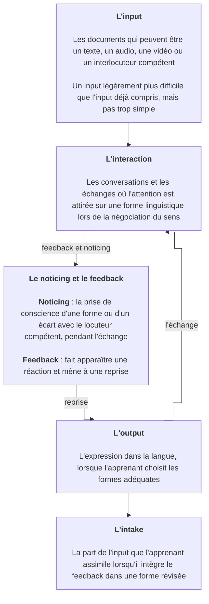
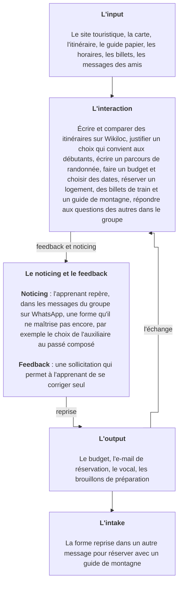

# Input, interaction, output : comment apprendre une langue ?

*Le modèle Input-Interaction-Output décrit comment un apprenant peut acquérir une langue seconde. La bonne compréhension des mécanismes cognitifs de cette acquisition facilite le travail de l'enseignant et permet de mieux guider l'apprenant.*

Quand on enseigne le français langue étrangère (FLE), on peut avoir des difficultés quand il s'agit d'évaluer comment une tâche apporte quelque chose à un apprenant. Le document pour l'apprenant est-il aligné à son niveau ? Quel genre d'échange doit-on provoquer ? Quel type de prise de parole doit-on favoriser ? Quelle est la meilleure manière de corriger un apprenant ? Ces questions sont importantes, parce que concevoir une tâche et gérer une correction efficace peut vraiment améliorer la qualité de l'acquisition de la langue.

## Le CECRL est un cadre de travail descriptif, pas un modèle d'apprentissage

Le [Cadre européen commun de référence pour les langues](/articles/cecrl/) (CECRL) propose un schéma descriptif pour représenter les activités langagières et les compétences d'un apprenant, du niveau A1 au C2. Ce modèle, qui est non prescriptif, décrit les capacités d'un apprenant ou d'un utilisateur d'une langue. Pour les professionnels du FLE, il est utile pour élaborer des séquences pédagogiques, des évaluations, des programmes ou encore des manuels. La [perspective actionnelle](/articles/perspective-actionnelle/), quant à elle, définit l'individu comme un acteur social capable d'agir en vue de réaliser des tâches. Toutefois, aucun des deux n'explique *comment un apprenant apprend*.

Dans cet article, je vous présente le modèle Input-Interaction-Output (IIO), son origine, ses évolutions, ce qu'il explique et ses limites. J'aime utiliser ce modèle cognitif, parce qu'à mon sens, il s'agit d'un complément au CECRL et à la perspective actionnelle. Autrement dit, il représente ce qui se passe dans le cerveau d'un apprenant de FLE. Je le trouve assez opérationnel pour enseigner.

## D'où vient le modèle Input-Interaction-Output ?

Ce modèle trouve son origine dans la recherche en acquisition des langues secondes. Il est possible de distinguer trois vagues successives dans ce champ interdisciplinaire. Chacune d'elles a ajouté un élément à l'ensemble du modèle IIO, de sorte qu'il décrit désormais relativement bien le processus cognitif d'un apprenant lorsqu'il assimile une langue étrangère.

### L'input compréhensible

Dans les années 1970 et 1980, Stephen D. Krashen formule un ensemble de cinq hypothèses sur l'acquisition des langues. L'une des plus célèbres est l'[hypothèse de l'input](https://www.sdkrashen.com/content/books/principles_and_practice.pdf#page=28).

> « Une condition nécessaire (mais non suffisante) pour passer du stade i au stade i + 1 est que l'apprenant comprenne un input qui contient i + 1, où comprendre signifie que l'apprenant se concentre sur le sens et non sur la forme du message. »[^krashen]

Selon Krashen, on peut modéliser la progression d'un apprenant par étapes. L'apprenant se trouve au stade **i**. Il peut atteindre le stade [**i + 1**](https://www.sdkrashen.com/content/books/principles_and_practice.pdf#page=28) à une seule condition : il doit comprendre le sens du message **i + 1** à partir de tout l'input déjà compris **i**. Donc, grâce aux acquis et au contexte, l'apprenant peut comprendre des messages qu'il ne maîtrise pas. Il s'agit d'une condition indispensable au progrès. Krashen considère que, si l'input est abondant lorsque l'apprenant est en immersion, cette difficulté supplémentaire se présente d'elle-même. Il mentionne d'autres facteurs qui entrent en jeu, comme le calme, la motivation et la confiance en soi.

Dans le modèle de Krashen, lire et écouter sont plus importants qu'écrire et parler. Il existe une différence entre l'apprentissage formel et conscient, et l'acquisition informelle et inconsciente. Par exemple, les règles de grammaire ou la prise de parole relèvent de l'apprentissage, tandis que la compréhension du message ou l'immersion sociale s'inscrivent dans l'acquisition. L'apprentissage ne joue ici qu'un rôle secondaire, celui de monitorer ce qui est appris par l'acquisition. Selon Krashen, l'output, c'est-à-dire la capacité d'écrire et de parler, [émerge spontanément](https://www.sdkrashen.com/content/books/principles_and_practice.pdf#page=29).

À cette époque, il était courant de recourir aux mathématiques en sciences humaines pour leur donner de la légitimité. Krashen formalisa donc le progrès par la relation incrémentale **i + 1**. Le niveau **i** d'un apprenant n'est pas mesurable. L'écart de **1** n'est pas plus quantifiable. Cette abstraction mathématique, aussi forte soit-elle sur le plan logique, manque de concret.

### L'output compréhensible

Les programmes d'immersion en français au Canada ont permis de tester à grande échelle les idées de Krashen. Dans ces parcours, des enfants anglophones vont à l'école en français dès la maternelle. Ils sont exposés à un input abondant pendant plusieurs années. Bien que les élèves en immersion soient aussi bons que les locuteurs natifs en compréhension écrite et orale, ils restent identifiables comme des locuteurs non natifs en expression écrite et orale. Dans les salles de classe, les élèves en immersion prennent peu la parole. À peine 14 % des prises de parole dépassent la longueur d'une proposition[^swain-1988]. À la suite de cette observation, Merrill Swain propose l'[hypothèse de l'output](https://books.google.com/books?id=2rv20RsUfmMC&pg=PA125) en 1985.

> « L'output peut amener les apprenants à passer du traitement sémantique, ouvert, non déterministe et stratégique, qui domine en compréhension, au traitement grammatical complet nécessaire à une production exacte. »[^swain]

Même si on peut comprendre un message avec le contexte et le vocabulaire, on ne peut pas écrire ou prendre la parole si on n'est pas capable de choisir précisément une forme appropriée. S'exprimer oblige un apprenant à faire des choix formels et conscients. Il [réfléchit à la forme](https://books.google.com/books?id=2rv20RsUfmMC&pg=PA128) qu'il utilise. Cet effort oblige l'apprenant à viser une forme qu'il ne maîtrise pas encore. Dans les années 1980 et 1990, Swain parvient à observer les [trois fonctions](https://books.google.com/books?id=2rv20RsUfmMC&pg=PA125) de l'output :

- **Le noticing** : l'apprenant remarque l'écart entre ce qu'il veut exprimer et ce qu'il sait exprimer ; ce noticing est un effet de l'output ;
- **Le test d'hypothèses** : il essaie une forme et ajuste ce qu'il exprime en fonction de la réaction de son interlocuteur ;
- **La réflexion métalinguistique** : il résout un problème en réfléchissant au fonctionnement de la langue.

Chez Swain, l'output peut faciliter l'apprentissage. Attention, rien ne dit que l'acquisition est automatique, et l'output n'est pas un remplacement de l'input. Aujourd'hui, la prévalence de l'input au début de l'apprentissage est établie. On sait que l'apprentissage formel peut alimenter l'acquisition inconsciente, et que l'output contrôlé favorise la mémorisation. Une prise de parole libre trop précoce favorise le recours à la traduction, ce qui institue de mauvaises habitudes syntaxiques chez l'apprenant. On commence à s'approcher de la réalité de l'assimilation d'une langue. Il manque encore à ces deux modèles un élément central : l'interaction.

### L'interaction et la négociation du sens

On peut trouver une réponse chez Michael H. Long qui formule l'hypothèse de l'interaction dans les années 1980 et 1990. Cette hypothèse est particulièrement intéressante parce qu'elle connecte l'input et l'output.

Long confirme que l'input abondant est une condition indispensable. Il ajoute que l'apprenant doit traiter cet input dans l'interaction. Il s'agit d'une situation d'échange avec un locuteur plus compétent que lui dans la langue qu'il apprend. Cet interlocuteur peut fournir du feedback. Entre un locuteur apprenant et un locuteur compétent, la communication peut connaître des difficultés ou même être bloquée. Ces frictions sont la base de l'acquisition pour l'apprenant. L'interlocuteur compétent peut répéter les informations, reformuler d'une autre manière, donner des exemples pour favoriser la compréhension et vérifier que l'apprenant a compris d'une autre manière.

> « La négociation du sens, et surtout le travail de négociation qui déclenche des ajustements interactionnels de la part du locuteur natif ou d'un interlocuteur plus compétent, facilite l'acquisition parce qu'elle relie l'input, les capacités internes de l'apprenant, en particulier l'attention sélective, et l'output de manière productive. »[^long]

Long explique que la négociation du sens est l'élément qui connecte l'input et l'output via un processus d'attention sélective. Dans la conversation, l'apprenant peut faire une pause sur le sens global de l'échange pour se concentrer sur un élément précis de la langue. C'est une opportunité pour donner du sens aux formes d'expression. À ce moment précis, l'apprenant a plus de chances de mémoriser le vocabulaire, la grammaire ou la prononciation.

## Le feedback correctif

Bien que le feedback correctif fasse progresser, ses effets dépendent de l'apprenant et du but recherché.

### En général

Les effets d'un type de feedback dépendent de la portée de la correction et de la réponse demandée à l'étudiant[^lyster-saito-sato] :

- Pendant une tâche, un feedback qui est limité à un type d'erreur améliore la rétention et est facilement observable par l'enseignant[^sheen] ; à l'inverse, corriger toutes les erreurs est lourd et dilue les effets du feedback ;
- De même, exiger une version corrigée produit une trace qui permet d'évaluer la réutilisation de la forme travaillée ; la simple prise de connaissance d'une erreur ne laisse aucune trace.

Le feedback correctif doit donc être ciblé et mobiliser l'apprenant à produire une trace.

### À l'oral

À l'oral, j'utilise la sollicitation ou l'indice pour pousser l'apprenant à produire une forme correcte. De cette manière, je lui signale l'erreur sans jamais lui communiquer la correction. La sollicitation et l'indice métalinguistique sont meilleures que le recast[^lyster-saito], et leurs effets durent plus longtemps. Je trouve que la sollicitation a peu de chances de fonctionner sur une forme que l'étudiant ne connaît pas encore. Lorsqu'il s'agit d'une nouvelle forme, je préfère utiliser un recast suivi d'une vérification. Si je travaille la fluidité, je reste silencieux et je prends des notes que je communiquerai a posteriori en utilisant le feedback approprié.

*Les différents types de feedback correctif à l'oral*[^lyster-ranta]

| La technique                    | Le principe                                             | Un exemple                                                                                                 | La réaction et la reprise                                                                           | Les effets                                                                                                        |
| ------------------------------- | ------------------------------------------------------- | ---------------------------------------------------------------------------------------------------------- | --------------------------------------------------------------------------------------------------- | ----------------------------------------------------------------------------------------------------------------- |
| **La sollicitation**            | Relancer pour faire produire la forme, sans la donner   | L'apprenant : « j'ai allé au cinéma »  L'enseignant : « Hier, je... ? »                              | Réaction systématique  L'apprenant répare souvent  Il ne reste jamais muet              | Le plus efficace en réparation  Suppose un apprenant actif  Peut bloquer l'apprenant s'il ne sait pas |
| **L'indice métalinguistique**   | Commenter la règle ou signaler la catégorie de l'erreur | L'apprenant : « j'ai allé au cinéma »  L'enseignant : « Attention à l'auxiliaire »                   | Réaction presque toujours  L'apprenant répare souvent                                         | Plus durable que le recast  Suppose la règle connue  Coupe l'échange                                  |
| **La correction explicite**     | Corriger en indiquant clairement que l'énoncé est faux  | L'apprenant : « j'ai allé au cinéma »  L'enseignant : « On ne dit pas j'ai allé, mais je suis allé » | Réaction irrégulière  L'apprenant répare parfois  La réparation est immédiate           | Fort sur la vérification immédiate  Moins durable  Coupe l'échange                                    |
| **Le recast**                   | Reformuler l'énoncé erroné sans signaler l'erreur       | L'apprenant : « j'ai allé au cinéma »  L'enseignant : « je suis allé au cinéma »                     | Passe souvent inaperçu  L'apprenant réagit rarement  Il répare rarement                 | Modeste chez le débutant  Plus utile chez l'avancé                                                          |
| **La répétition**               | Répéter l'énoncé erroné avec une intonation montante    | L'apprenant : « j'ai allé au cinéma »  L'enseignant : « Tu as allé au cinéma ? »                     | Réaction souvent  L'apprenant répare parfois  Mais parfois, il ne réagit pas            | Peut passer pour une question de sens                                                                             |
| **La demande de clarification** | Signaler qu'on n'a pas compris, sans nommer l'erreur    | L'apprenant : « j'ai allé au cinéma »  L'enseignant : « Pardon ? »                                   | Réaction presque toujours  L'apprenant répare rarement  Il répète souvent la même forme | Utile si le sens bloque vraiment  Ambigu quand le sens est clair  Fragile pour un problème de forme   |

### À l'écrit

À l'écrit, je me concentre sur une catégorie d'erreur et je demande une version révisée à l'apprenant. Je corrige aussi directement, tout en ajoutant une explication métalinguistique. Cette approche a de meilleurs effets à long terme que la correction directe seule[^kang-han]. Toutefois, sans demande de version révisée, les effets du feedback sont relativement fragiles. L'apprenant ne laisse aucune trace, je ne peux rien vérifier, et surtout, il voit l'erreur sans la corriger lui-même. C'est important aussi de limiter les annotations. Une correction qui reprend toutes les erreurs dilue la capacité de l'étudiant à se concentrer sur les erreurs qui sont importantes à son niveau et perd l'effet que je recherche. Enfin, sur une erreur récurrente, je préfère nommer la règle plutôt que de corriger sa forme.

*Les différents types de feedback correctif à l'écrit*[^ellis]

| La technique                        | Le principe                                         | Un exemple                                                                                                                        | La réaction et la reprise                                                                                        | Les effets                                                                                                                                |
| ----------------------------------- | --------------------------------------------------- | --------------------------------------------------------------------------------------------------------------------------------- | ---------------------------------------------------------------------------------------------------------------- | ----------------------------------------------------------------------------------------------------------------------------------------- |
| **La correction directe**           | Écrire la forme correcte à la place de l'erreur     | L'apprenant écrit : « j'ai allé au cinéma »  L'enseignant barre et écrit : « je suis allé au cinéma »                       | L'apprenant voit la forme juste  Il peut la recopier dans la révision sans comprendre la règle             | Fort si la version révisée est demandée  Rétention moyenne                                                                          |
| **Le commentaire métalinguistique** | Nommer la règle au lieu de donner la forme          | L'apprenant écrit : « j'ai allé au cinéma »  L'enseignant barre et écrit : « auxiliaire être avec les verbes de mouvement » | L'apprenant relit la règle  La reprise est plus lente et demande un support                                | Plus durable si la version révisée est demandée  Bonne rétention sur une erreur récurrente                                          |
| **Le signalement indirect**         | Signaler l'erreur sans la corriger                  | L'apprenant écrit : « j'ai allé au cinéma »  L'enseignant barre ou souligne : « j'ai allé »                                 | L'apprenant doit identifier seul  Il répare s'il connaît la règle  Sinon, il ne voit pas le problème | Exige une version révisée, sinon l'effet est presque nul  Utile si l'apprenant est autonome, mais fragile chez l'apprenant débutant |
| **La reformulation**                | Réécrire le texte, l'apprenant compare les versions | L'apprenant : « j'ai allé au cinéma »  L'enseignant rend : « je suis allé au cinéma », avec la version d'origine            | L'apprenant compare  Il repère les écarts                                                                  | Besoin d'une version révisée quasi nul  Bon sur le style et l'organisation  Charge de lecture et de révision élevée           |
| **L'hyperlien**                     | Signaler par un lien vers une autre ressource       | L'apprenant : « j'ai allé au cinéma »  L'enseignant partage un lien vers la forme correcte et son explication               | L'apprenant ouvre le lien  Il corrige s'il est guidé  Il risque d'ignorer les annotations            | Utile si la version révisée est demandée  Dépend de la lecture et de l'autonomie de l'apprenant                                     |

Les enjeux autour du feedback sont très intéressants, mais je trouve qu'ils ont tendance à trop concentrer l'attention des enseignants et à dériver vite vers quelque chose du genre : « moi, je préfère faire ça » comme si c'était une affaire de goût alors qu'il existe des méta-analyses sur le sujet. Les techniques sont des outils, pas des goûts. Et n'oubliez pas l'importance de l'input, de l'interaction et de l'output si vous voulez vraiment aider vos apprenants.

## Le modèle Input-Interaction-Output est une synthèse

Susan M. Gass et Alison Mackey, dans la fin des années 2000, reprennent ces courants et les organisent dans le modèle Input-Interaction-Output (IIO). Je préférerais qu'il s'appelle Input-Interaction-Feedback-Output-Intake, mais c'est le nom qu'elles ont choisi, et il faut dire que c'est plus facile à retenir. Dans leur modèle, l'interaction permet de connecter l'input que l'apprenant comprend et l'output que l'apprenant exprime. À l'intérieur de cette interaction, s'opère le feedback correctif. Le noticing y désigne la prise de conscience d'une forme ou d'un écart que l'apprenant identifie pendant l'échange, face à un interlocuteur plus compétent. C'est un autre sens que celui de Swain, qui le définit comme l'écart entre ce que l'apprenant veut dire et ce qu'il sait dire.

> « L'approche interactionniste cherche à rendre compte de l'apprentissage par l'exposition de l'apprenant à la langue, par sa production langagière et par le feedback sur cette production. »[^gass]

Ce modèle n'est pas une théorie générale de l'apprentissage : c'est une explication psycholinguistique, et Gass et Mackey le disent elles-mêmes. Il ne couvre pas tous les facteurs de l'acquisition et ne se substitue pas aux approches qui insistent sur le contexte social et culturel.

_Les composants du modèle Input-Interaction-Output_

Il est très important de comprendre que ce modèle n'est pas une séquence linéaire. Il s'agit plutôt d'un cycle où les éléments se combinent. L'interaction peut fournir de l'input, elle peut provoquer un output et donner du feedback dans un seul et même échange. Un output peut aussi être situé avant l'input et créer de l'interaction et du feedback. Je vous recommande de toujours compléter la boucle et viser l'intake.

Il faut aussi retenir ici que le modèle est utile à plusieurs niveaux. Il est pratique autant en classe que dans la conception pédagogique. La qualité réelle d'un programme pédagogique, à mon sens, peut être évaluée grâce au nombre d'échanges qu'il est capable de susciter pour faire émerger des situations de négociation du sens, avec du noticing côté apprenant et du feedback côté enseignant.

Une dernière chose, il faut garder à l'esprit que l'intake n'est jamais garanti. L'enseignant ne peut pas garantir un apprentissage avec certitude, mais il peut créer un meilleur contexte d'acquisition.

## Concevoir une tâche avec le modèle

Un apprentissage organisé autour de la tâche comme unité d'analyse multiplie les occasions de feedback correctif. Dans ce cadre, la tâche prend la forme d'un problème à résoudre, et les solutions à trouver font naître des frictions. Ces frictions offrent le plus d'occasions de négocier le sens, donc de produire du noticing et du feedback. Tout le but du jeu est de maximiser l'intake.

Lors de la conception d'un cours, d'une séquence pédagogique ou d'un programme, il faut s'assurer qu'à chaque tâche, il y ait de l'input, de l'interaction et de l'output, évidemment dosés en fonction du niveau et des besoins de l'apprenant. À titre personnel, j'essaie d'anticiper les feedbacks possibles pour une tâche, sans pour autant trop chercher leur planification, puisque cela pourrait dénaturer la spontanéité de la friction recherchée.

Par exemple, un apprenant qui n'a jamais vu le passé composé aura besoin d'un recast et d'une explication, tandis qu'une sollicitation ou un indice convient mieux à quelqu'un qui connaît déjà la règle. L'explication métalinguistique s'improvise avec l'expérience. Si vous êtes un enseignant débutant, préparez-vous pour être clair et éviter la confusion auprès de l'apprenant.

Voyons le modèle à l'œuvre sur le scénario « Planifier une randonnée dans les Alpes avec un groupe d'amis sur WhatsApp ».

_Les composants du modèle appliqués à la tâche_

## Gérer l'asymétrie

Enseigner sans trop parler est un art. Je surveille rigoureusement mon temps de parole. Je vise 20 à 30 % pour moi et 70 à 80 % pour le ou les apprenants. Si je parle trop, cela signifie que je parle à leur place et que j'étouffe la possibilité d'un échange.

En cours particulier, la relation asymétrique est plus simple à tenir qu'en groupe parce que je suis le seul interlocuteur plus compétent. Le feedback est immédiat et je peux adapter mon input à la compréhension de l'apprenant. La prise de conscience dépend entièrement de ce que je signale. J'ai donc un meilleur contrôle de l'échange.

Dans un cours avec un petit groupe d'apprenants, c'est différent. D'abord, je ne donne pas de sous-tâches différentes à des sous-groupes. Je donne la même sous-tâche à tous les sous-groupes, pour que les groupes comparent leurs solutions. J'essaie aussi de placer les apprenants les plus compétents avec les moins compétents, là aussi pour favoriser le noticing dans le groupe.

Quand on travaille en groupe, il faut bien garder en tête la nécessité de la relation asymétrique pour que les écarts de niveau apparaissent dans les échanges à l'intérieur des sous-groupes, qui sont toujours supervisés par l'enseignant, qui est l'interlocuteur le plus compétent de la classe, et le plus apte à contrôler l'asymétrie. Je fais aussi attention aux plus bavards et compétents. Je veille à l'équité, et non à l'égalité, du temps de parole à l'intérieur des sous-groupes.

L'asymétrie ne veut pas dire que vous devez montrer votre supériorité et votre autorité dans la manipulation du français, mais plutôt que vous devez jouer le rôle d'un guide vers un meilleur usage grâce à votre expérience et vos connaissances.

Bref, soyez sympa et à l'écoute !

[^lyster-saito]: Roy Lyster et Kazuya Saito, « Oral Feedback in Classroom SLA: A Meta-Analysis », *Studies in Second Language Acquisition*, vol. 32, no 2, 2010. [Consulter](https://doi.org/10.1017/S0272263109990520).
[^lyster-ranta]: Roy Lyster et Leila Ranta, « Corrective Feedback and Learner Uptake: Negotiation of Form in Communicative Classrooms », *Studies in Second Language Acquisition*, vol. 19, no 1, 1997. [Consulter](https://doi.org/10.1017/S0272263197001034).
[^lyster-saito-sato]: Roy Lyster, Kazuya Saito et Masatoshi Sato, « Oral Corrective Feedback in Second Language Classrooms », *Language Teaching*, vol. 46, no 1, 2013. [Consulter](https://doi.org/10.1017/S0261444812000365).
[^sheen]: Younghee Sheen, « The Effect of Focused Written Corrective Feedback and Language Aptitude on ESL Learners' Acquisition of Articles », *TESOL Quarterly*, vol. 41, no 2, 2007. [Consulter](https://doi.org/10.1002/j.1545-7249.2007.tb00059.x).
[^ellis]: Rod Ellis, « A Typology of Written Corrective Feedback Types », *ELT Journal*, vol. 63, no 2, 2009. [Consulter](https://doi.org/10.1093/elt/ccn023).
[^kang-han]: EunYoung Kang et Zhaohong Han, « The Efficacy of Written Corrective Feedback in Improving L2 Written Accuracy: A Meta-Analysis », *The Modern Language Journal*, vol. 99, no 1, 2015. [Consulter](https://doi.org/10.1111/modl.12189).
[^gass]: Susan M. Gass et Alison Mackey, « Input, Interaction, and Output in Second Language Acquisition », dans Bill VanPatten et Jessica Williams (dir.), *Theories in Second Language Acquisition: An Introduction*, 2e éd., Routledge, 2015. [Consulter](https://doi.org/10.4324/9780203628942). Traduction de l'anglais.
[^krashen]: Stephen D. Krashen, *Principles and Practice in Second Language Acquisition*, Pergamon, 1982. [Consulter](https://www.sdkrashen.com/content/books/principles_and_practice.pdf#page=28). Traduction de l'anglais.
[^long]: Michael H. Long, « The Role of the Linguistic Environment in Second Language Acquisition », dans William C. Ritchie et Tej K. Bhatia (dir.), *Handbook of Second Language Acquisition*, Academic Press, 1996. [Consulter](https://doi.org/10.1016/B978-012589042-7/50015-3). Traduction de l'anglais.
[^swain]: Merrill Swain, « Three Functions of Output in Second Language Learning », dans Guy Cook et Barbara Seidlhofer (dir.), *Principle and Practice in Applied Linguistics: Studies in Honour of H. G. Widdowson*, Oxford University Press, 1995. [Consulter](https://books.google.com/books?id=2rv20RsUfmMC&pg=PA125). Traduction de l'anglais.
[^swain-1988]: Merrill Swain, « Manipulating and Complementing Content Teaching to Maximize Second Language Learning », *TESL Canada Journal*, vol. 6, no 1, 1988. [Consulter](https://doi.org/10.18806/tesl.v6i1.542).